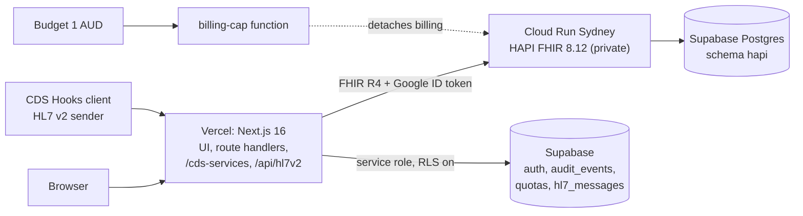

# ClinIQ

A small EHR-style clinical app built to show Australian health-interoperability skills: a private
FHIR R4 server in Sydney, an Australian synthetic cohort, a patient chart with pathology and vital
trends, a CDS Hooks decision-support service, and HL7 v2 pathology results mapped to FHIR with ACKs.

> **Honest framing.** Portfolio prototype. Synthetic data only (Synthea, Australianised; the IHIs are
> reserved test values). Not a medical device, not clinically validated, no regulatory claim.
> Decision-support cards are informational demos.

**Live:** https://cliniq-inky-ten.vercel.app. Sign in with the "Sign in as demo clinician" button.
Outside Australian daytime the FHIR server is asleep (Cloud Run scales to zero), so the first
request can take about a minute to wake it (57 s measured).

## What it does

- **Chart:** worklist, banner with allergies, problems, medicines, immunisations, encounters;
  pathology and vitals trend charts by analyte; a "View FHIR JSON" drawer on every row.
- **Decision support:** CDS Hooks `patient-view` service (eGFR by CKD-EPI 2021, BMI, diabetes and
  hypertension care gaps), driven by prefetch only. The chart shows the same cards from the same rules.
  See [`docs/cds-hooks.md`](docs/cds-hooks.md).
- **HL7 v2 in:** `POST /api/hl7v2` takes an ORU^R01, maps it to a FHIR transaction, validates it with
  `$validate`, writes it and replies with an ACK. Repeats are idempotent, corrections update the same
  Observation, unknown patients are rejected (never created), failures are kept in a message log.
  Try it on `/hl7` with a dry run.
- **Notes to coded FHIR:** `/pipeline` extracts findings from a clinical note (medspaCy), codes them to SNOMED CT-AU, validates the
  result and writes unconfirmed Conditions with Provenance. Negated, family, hypothetical, uncertain and historical mentions are
  never written. Every finding waits in `/review` for a clinician to confirm, change the code, or reject it.
- **Safety and operations:** sign-in, an audit log shaped like FHIR AuditEvent, daily quotas, security
  headers ([`docs/SECURITY.md`](docs/SECURITY.md)), and a budget-triggered spend cap on the cloud project (the billing-detach step itself is untested).

## Architecture



The browser never talks to the FHIR server; only the app's service account can invoke it.

## Standards and versions

| Area | Used |
|---|---|
| FHIR | R4 (4.0.1), HAPI FHIR server `hapiproject/hapi:v8.12.0-2` |
| Profiles | AU Patient Summary 1.0.0 export (validated); AU Core 2.0.0: every cohort resource that claims an AU Core profile validates ([report](docs/validation/au-core-cohort.md)) |
| Identifiers | IHI (`http://ns.electronichealth.net.au/id/hi/ihi/1.0`), reserved test values |
| Codes | LOINC for pathology and vitals, UCUM units, SNOMED CT-AU 20261031 for coding conditions, SNOMED CT from Synthea in the cohort |
| HL7 v2 | 2.4 ORU^R01 in the style of Australian pathology (AS 4700.2), mapped following the HL7 v2-to-FHIR guide. Hand-written parser |
| CDS Hooks | `patient-view`, prefetch only. Sandbox check still to do |
| Calculators | CKD-EPI 2021 eGFR (race-free), BMI |
| Stack | Next.js 16, React 19, TypeScript strict, Recharts, Supabase Auth, Vitest, Playwright, axe |

Not built yet: SMART on FHIR launch, the chart assistant, the evaluation report. ICD-10-AM is not included: it is licensed by
IHACPA. See [`SPEC.md`](SPEC.md) for the plan.

## Status

| Milestone | State |
|---|---|
| M0 Foundation and live skeleton | Done |
| M1 Australian cohort | Done — 20 patients, [AU Core validation report](docs/validation/au-core-cohort.md) |
| M2 Private FHIR server in Sydney | Built. Cold start measured (about 57 s); 48 h cost check and keep-alive pinger pending |
| M3 Design system and chart | Built — worklist, patient chart, tokens, Playwright smoke + axe, [screenshots](docs/ui/screens/m3) |
| M4 Pathology, vitals, FHIR JSON | Built — L1–L11 pass, [screenshots](docs/ui/screens/m4) |
| M5 CDS Hooks service | Built — E1–E14, BMI and care-gap tests pass; sandbox check pending ([docs](docs/cds-hooks.md)) |
| M6 | Done: one-click demo sign-in, audit log, daily quotas, security headers (`docs/SECURITY.md`) |
| M7 | Done: HL7 v2 ORU^R01 → FHIR with ACKs, `/hl7` page, message log. Verified live ([screenshot](docs/ui/screens/m7/live-pathology.png)) |
| M8 | Done: AU Patient Summary export (readable view + FHIR JSON), 0 validator errors on 3 patients ([report](docs/validation/au-ps.md)) |
| M9 | Built: medspaCy NLP service on Cloud Run (C1–C16 pass), `precomputed` fallback. Needs the invoker grant and `NLP_SERVICE_URL` |
| M10 | Built: SNOMED CT-AU coding (NCTS when credentials exist, CSIRO test endpoint, offline for tests), live run 0 mismatches ([report](docs/validation/terminology.md)) |
| M11 | Built: note → code → validate → write as unconfirmed Conditions with Provenance; `/review` queue (confirm, change, reject); W1–W12 pass locally |
| M12–M15 | Not started |

Decisions and their reasons are in [`DECISIONS.md`](DECISIONS.md); the build is specified in [`SPEC.md`](SPEC.md); the plan and next steps are in
[`docs/PLAN.md`](docs/PLAN.md); decisions are in [`DECISIONS.md`](DECISIONS.md).

## Run locally

Needs Node 24+ and Docker.

```bash
cp .env.example .env.local   # FHIR_BASE_URL=http://localhost:8080/fhir is already set
npm install
docker compose up -d         # HAPI FHIR + Postgres on localhost:8080
npm run load                 # loads the 20 synthetic patients (safe to run twice)
npm run dev                  # app on http://localhost:3000
npm run ci                   # lint, typecheck, unit tests, build
```

Without `FHIR_BASE_URL` the app starts and shows a "FHIR server not configured" notice.

The cohort in `data/cohort/` is built from Synthea output by `npm run cohort:build` and validated
against AU Core by `npm run cohort:validate` (see [`docs/validation`](docs/validation/README.md)).
All data is synthetic.
